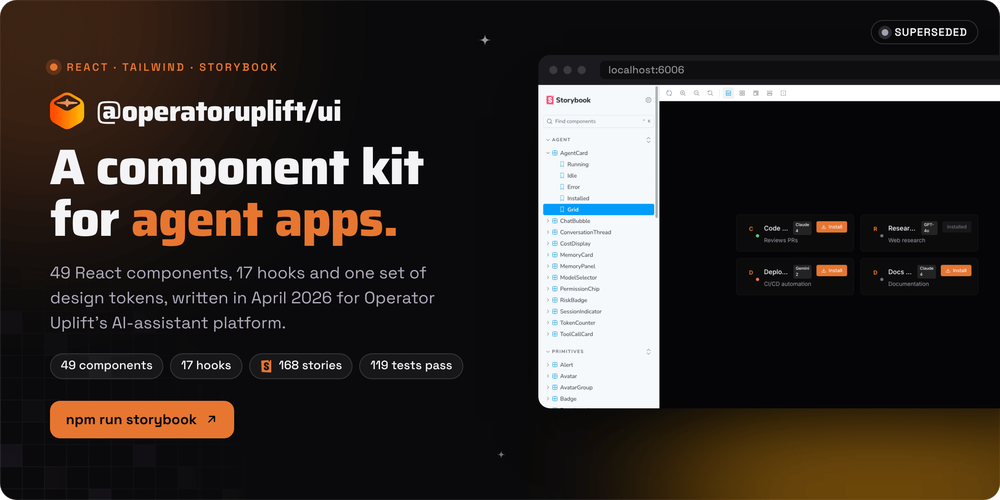

<div align="center">



<br><br>

<a href="#run-it-locally"></a>&nbsp;&nbsp;
<a href="#components"></a>&nbsp;&nbsp;
<a href="https://operatoruplift.com"></a>

<br><br>


<a href="LICENSE"></a>

<h3>React components for agent apps, from Operator Uplift's AI-assistant era.</h3>

<b>Build</b> &nbsp;→&nbsp; <b>Pack</b> &nbsp;→&nbsp; <b>Install</b> &nbsp;→&nbsp; <b>Import</b> &nbsp;→&nbsp; <b>Compose</b>

<br>

<a href="#how-it-works">How it works</a> &nbsp;·&nbsp;
<a href="#status">Status</a> &nbsp;·&nbsp;
<a href="#where-it-fit">Where it fit</a> &nbsp;·&nbsp;
<a href="#run-it-locally">Run it locally</a> &nbsp;·&nbsp;
<a href="#components">Components</a>

</div>

<br>

<picture>
  <source media="(prefers-color-scheme: dark)" srcset="docs/readme/screens-dark.png">
  
</picture>

<p align="center"><sub>Captured from a local Storybook build on 30 October 2026.</sub></p>

**`@operatoruplift/ui` is the React component library written in April 2026 for Operator Uplift's AI agent apps.** It packs 49 components, from buttons and tables to agent cards, tool call rows and a memory panel, plus 17 hooks and one set of dark, orange design tokens, into a single package with a Tailwind preset and a Storybook. It was meant to be shared by the website, the developer console and the desktop shell, but it was never published to npm and none of them imported it. Operator Uplift pivoted to commitment infrastructure on 22 May 2026, so this repo is a record of that earlier platform. It still builds, type-checks, tests and renders.

The repo started in December 2025 as an Electron desktop assistant (`aven-assistant`, renamed Uplift Assistant in January 2026), begun by Dhruv Aggarwal. The library replaced it in [pull request 1](https://github.com/operatoruplift/UI/pull/1) on 1 April 2026, and the old app's source is still in `src/`.

<br>

## How it works

<picture>
  <source media="(prefers-color-scheme: dark)" srcset="docs/readme/flow-dark.png">
  
</picture>

<table>
  <tr valign="top">
    <td width="33%"><b>Tokens live in CSS variables</b><br><sub>Colors and radii are <code>--ou-*</code> variables in <code>src/styles/globals.css</code>. The compiled <code>styles.css</code>, the Tailwind preset and the exported <code>designTokens</code> object carry the same values, so an app can retheme by overriding variables.</sub></td>
    <td width="33%"><b>Ready for server rendering</b><br><sub>40 of the 49 components start with the <code>"use client"</code> directive for the Next.js App Router. A packed build renders through <code>react-dom/server</code> and imports from both ESM and CommonJS.</sub></td>
    <td width="33%"><b>No keys, no network</b><br><sub>The library reads no environment variables and makes no network requests. The memory hooks store through an adapter you pass in, and a <code>localStorage</code> adapter ships with them.</sub></td>
  </tr>
</table>

<p align="center"><sub>React 18 and 19 · TypeScript 5 · Tailwind CSS 3.4 · class-variance-authority · tailwind-merge · lucide-react · Vite 6 library mode · vite-plugin-dts · Storybook 8.6 · Vitest 2 · Testing Library · happy-dom</sub></p>

<br>

## Status

<table>
  <tr valign="top">
    <td width="16%" align="center"></td>
    <td>The component library, version 0.1.0. On 30 October 2026 it installed, type-checked, passed 119 of 119 Vitest tests, built its package and built a Storybook of 168 stories. It was never published to npm, and the apps it was written for never imported it. The current product is <a href="https://operatoruplift.com">Operator Uplift</a>: one small daily action, proved with a photo, and an AI Game Master decides whether the day counts.</td>
    <td width="22%"><a href="https://operatoruplift.com">operatoruplift.com</a></td>
  </tr>
  <tr valign="top">
    <td align="center"></td>
    <td>The Uplift Assistant Electron app in <code>src/</code> (December 2025 to January 2026): Supabase sign-in, chat, voice chat, an agent store and a workspace for installed agents. Its dependencies and build scripts left <code>package.json</code> in April 2026, so it no longer builds from this repo.</td>
    <td><a href="https://github.com/operatoruplift/UI/pull/1">Pull request 1</a></td>
  </tr>
</table>

<br>

## Where it fit

Operator Uplift was first pitched as AI for your inbox and calendar, built across several repos. This one held the shared interface.

<table>
  <tr>
    <th width="30%" align="left">Repo</th>
    <th width="70%" align="left">Role in the AI-assistant platform</th>
  </tr>
  <tr valign="top">
    <td><b>UI</b> (this repo)</td>
    <td>Shared React components and design tokens. Before April 2026, the Uplift Assistant desktop app.</td>
  </tr>
  <tr valign="top">
    <td><a href="https://github.com/operatoruplift/webview"><b>webview</b></a></td>
    <td>The Tauri desktop shell and an Android WebView shell, both loading operatoruplift.com.</td>
  </tr>
  <tr valign="top">
    <td><b>developer_console</b> (private)</td>
    <td>A Vite and React console for agent builders: prompt playground, debugger, logs, memory and MCP pages.</td>
  </tr>
  <tr valign="top">
    <td><b>core</b> (private)</td>
    <td>The agent runtime that the console and the desktop shell were meant to reach on <code>localhost:3001</code>.</td>
  </tr>
  <tr valign="top">
    <td><b>calendar_agent</b>, <b>x402-agent</b>, <b>project_space</b> (private)</td>
    <td>Google Calendar tools, x402 agent payments on Solana, and an internal project tracker.</td>
  </tr>
  <tr valign="top">
    <td><a href="https://github.com/operatoruplift/uplift-ai-chatbot"><b>uplift-ai-chatbot</b></a></td>
    <td>A deployment of Vercel's Chat SDK template.</td>
  </tr>
</table>

<br>

## Run it locally

<table>
  <tr valign="top">
    <td width="33%"><b>Prerequisites</b><br><sub>Node 22 and npm. Checked with Node 22.22.0 and npm 10.9.4 on 30 October 2026.</sub></td>
    <td width="33%"><b>Read first</b><br><sub><a href="CONTRIBUTING.md">CONTRIBUTING.md</a>: how to add a component with its story and test, and the token, border and radius conventions.</sub></td>
    <td width="33%"><b>What the checks prove</b><br><sub>119 Vitest tests in 26 files render components in happy-dom and check variants and states; 12 of the files also simulate clicks or typing. <code>tsc</code> covers the library. Nothing here runs a real Next.js or Tauri app.</sub></td>
  </tr>
</table>

### 1. Browse the components

```bash
npm ci
npm run storybook          # Storybook at http://localhost:6006 (npm run dev does the same)
```

### 2. Check and build

```bash
npm run lint               # tsc over the library
npm test                   # 119 Vitest tests in 26 files
npm run build              # dist/: ESM and CJS bundles, type declarations and styles.css
npm run build-storybook    # a static Storybook in storybook-static/
```

### 3. Use it in an app

The package is not on npm, so build it and install the tarball:

```bash
npm run build && npm pack   # writes operatoruplift-ui-0.1.0.tgz
cd ../your-app
npm install path/to/UI/operatoruplift-ui-0.1.0.tgz
```

Import the stylesheet once, at the root of your app:

```tsx
import "@operatoruplift/ui/styles.css";
```

Add the preset to a Tailwind CSS 3 config, so your own classes use the same tokens:

```ts
// tailwind.config.ts
import type { Config } from "tailwindcss";
import { upliftPreset } from "@operatoruplift/ui/tailwind-preset";

export default {
  presets: [upliftPreset],
  content: ["./src/**/*.{ts,tsx}", "./node_modules/@operatoruplift/ui/dist/**/*.js"],
} satisfies Config;
```

Then compose:

```tsx
import { Button, Badge, Card, CardContent } from "@operatoruplift/ui";

export function App() {
  return (
    <Card>
      <CardContent>
        <Badge variant="success">Active</Badge>
        <Button variant="primary" size="md">
          Get Started
        </Button>
      </CardContent>
    </Card>
  );
}
```

<details>
<summary><b>The memory system</b></summary>
<br>

`useMemory` keeps agent memories in three layers: an index that is always loaded (pointers only, capped at 200 entries), topic files fetched on demand, and a search across topics. It writes the topic first and the index second, so the index never points at a missing topic. `useMemoryConsolidation` merges, prunes and removes duplicates.

```tsx
import { MemoryPanel, createLocalStorageAdapter, useMemory } from "@operatoruplift/ui";

const adapter = createLocalStorageAdapter("my-app");

export function Memories() {
  const { index, save, search, remove, count, atCapacity } = useMemory({ adapter });

  async function remember() {
    await save({ name: "Prefers short replies", description: "Keep answers brief", type: "feedback", content: "Skip recaps." });
    const results = await search("replies"); // each result has the entry, a 0 to 1 score and a snippet
    console.log(results.map((r) => r.entry.name));
  }

  return <MemoryPanel entries={index.entries} count={count} atCapacity={atCapacity} onCreate={remember} onDelete={remove} />;
}
```

Memory types are `user`, `feedback`, `project` and `reference`. Any storage works if it implements `MemoryStorageAdapter`.

</details>

<details>
<summary><b>Design tokens</b></summary>
<br>

| Token | Value | CSS variable |
|---|---|---|
| Primary (Operator Orange) | `#E77630` | `--ou-primary` |
| Secondary (Amber) | `#F59E0B` | `--ou-secondary` |
| Background (Void) | `#050508` | `--ou-background` |
| Card | `#0c0c0c` | `--ou-card` |
| Text | `#ffffff` | `--ou-foreground` |
| Muted text | `#9ca3af` | `--ou-muted-foreground` |
| Border | `rgba(255,255,255,0.05)` | `--ou-border` |
| Destructive | `#ef4444` | `--ou-destructive` |
| Radius | `0.25rem`, `0.375rem`, `0.5rem`, `0.75rem` | `--ou-radius-sm`, `-md`, `-lg`, `-xl` |

Read them in code with `designTokens`, which also carries success `#22c55e`, warning `#f59e0b` and info `#3b82f6`:

```ts
import { designTokens } from "@operatoruplift/ui";
console.log(designTokens.primary); // "#E77630"
```

Known limit: the token colors are plain `var()` values, so Tailwind cannot apply opacity modifiers to them. Classes such as `bg-primary/20` (26 uses in the components) generate no CSS.

</details>

<details>
<summary><b>Hooks</b></summary>
<br>

| Hook | Use |
|---|---|
| `useLocalStorage` | State persisted to `localStorage` and synced across tabs |
| `useMediaQuery`, `useIsMobile`, `useIsTablet`, `useIsDesktop` | Responsive breakpoints |
| `useDebounce`, `useDebouncedCallback` | Debounced values and callbacks |
| `useClipboard` | Copy to the clipboard with an auto-reset flag |
| `useKeyboard`, `useHotkey` | Keyboard shortcuts |
| `useOnClickOutside` | Clicks outside an element |
| `useStreamingText` | Text revealed as it streams, for AI responses |
| `useCostTracker` | Token and cost tracking for AI sessions |
| `useMemory`, `useMemoryConsolidation` | The memory system above |
| `useTheme`, `useToast` | Accessors for `ThemeProvider` and `ToastProvider` |

</details>

<details>
<summary><b>Repository layout</b></summary>
<br>

| Path | Contents |
|---|---|
| `src/components/*.tsx` | The 49 library components, each with a `.stories.tsx`; 26 also have a `.test.tsx` |
| `src/hooks/` | The 17 hooks, with the memory system in `src/hooks/memory/` |
| `src/index.ts` | The barrel export: every component, hook, type and the tokens |
| `src/tailwind-preset.ts`, `tailwind.config.ts` | The tokens as a Tailwind preset, and the config the library's CSS is built with |
| `src/styles/globals.css` | The `--ou-*` variables and base styles compiled into `dist/styles.css` |
| `.storybook/` | Storybook config, with the dark "void" background |
| `src/App.tsx`, `src/main.ts`, `src/preload.ts`, `src/renderer.*`, `src/views/`, `src/services/`, `src/store/`, `src/components/ui/`, `src/components/auth/`, `src/config/`, `src/models/`, `src/types/`, `src/lib/supabase.ts`, `src/lib/timeout.ts`, `src/styles/input.css`, `tailwind.config.js`, `index.html`, `assets/`, `.env.example` | The old Uplift Assistant Electron app. Not built, exported or type-checked. |

</details>

<br>

## Components

49 components in six Storybook groups, every one exported from `src/index.ts` with its props type.

<details>
<summary><b>Primitives (19)</b></summary>
<br>

| Component | What it does |
|---|---|
| `Button` | Primary, outline, ghost and danger variants, three sizes, loading state and icons |
| `Badge` | Status labels: default, primary, success, warning and danger |
| `Card` | Default, glass and glass-dark containers with header, title, content and footer parts |
| `Input` | Text, password with show and hide, and search, with icon and error states |
| `Textarea` | Label, error state and auto-resize |
| `Toggle` | An animated on and off switch |
| `Select` | A dropdown with search and multi-select |
| `Tooltip` | Hover tooltips on any side, with an arrow |
| `Toast` | Auto-dismissing success, error, warning and info notices, through `ToastProvider` |
| `Alert` | Inline info, success, warning and error banners that can be dismissed |
| `Avatar` | Image, initials fallback and status dot |
| `AvatarGroup` | Stacked avatars with an overflow count |
| `Dropdown` | A menu with items, dividers and danger items |
| `Tabs` | Default, pills and underline variants |
| `Breadcrumb` | Breadcrumbs with a custom separator |
| `Kbd`, `Shortcut` | Keyboard keys and shortcuts |
| `Divider` | Horizontal or vertical, with an optional label |
| `LoadingSpinner` | A spinner with a label and an optional fullscreen overlay |
| `CopyButton` | Copy to the clipboard with a confirmation |

</details>

<details>
<summary><b>Layout (5)</b></summary>
<br>

| Component | What it does |
|---|---|
| `Sidebar` | Collapsible navigation with sections and icons |
| `Header` | Logo, navigation links and a slot for a user menu |
| `PageWrapper` | A page layout with a maximum width |
| `Modal` | A centered overlay with a blurred backdrop that closes on Escape |
| `CommandPalette` | Grouped commands, filtering and arrow-key navigation; your app decides when it opens |

</details>

<details>
<summary><b>Data display (7)</b></summary>
<br>

| Component | What it does |
|---|---|
| `Table` | Sortable columns, pagination and row selection |
| `StatCard` | A value, a label and a change indicator |
| `ProgressBar` | Determinate and indeterminate progress |
| `Skeleton` | Text, circular and rectangular placeholders |
| `EmptyState` | An icon, a message and an action |
| `CodeBlock` | Code with a filename, line numbers and a copy button |
| `StatusDot` | An animated dot for online, offline, idle, busy, away, running and error |

</details>

<details>
<summary><b>Agent (12)</b></summary>
<br>

| Component | What it does |
|---|---|
| `AgentCard` | Avatar, name, status dot, model badge and install button |
| `ChatBubble` | User and assistant messages with a copy button |
| `ConversationThread` | Messages and tool calls in one thread |
| `ToolCallCard` | An expandable tool call with status, timing, input and output |
| `MemoryCard` | An expandable memory entry that fetches its content on demand |
| `MemoryPanel` | Search, type filters and create, edit and delete callbacks for memories |
| `ModelSelector` | A model dropdown with a badge for each provider |
| `TokenCounter` | Token usage with a breakdown and a limit bar |
| `CostDisplay` | Spend with a change indicator |
| `SessionIndicator` | An active session count with an animated dot |
| `PermissionChip` | An icon and label for a granted or denied permission |
| `RiskBadge` | An A to F grade with color coding |

</details>

<details>
<summary><b>Effects (5) and providers (1)</b></summary>
<br>

| Component | What it does |
|---|---|
| `SpotlightCard` | A gradient highlight that follows the mouse |
| `GlowButton` | A button with an animated glow on hover |
| `FadeIn` | Fades content in when it scrolls into view (IntersectionObserver) |
| `DotGlobe` | A rotating globe of dots drawn on a canvas |
| `StreamingText` | Text that streams in with a cursor |
| `ThemeProvider` | Dark, light or system theme, remembered in `localStorage` |

</details>

<br>

<p align="center"><sub>MIT licensed, copyright 2026 Operator Uplift (see <a href="LICENSE">LICENSE</a>); dependencies keep their own licenses.</sub></p>

<p align="center"><sub>Built by <a href="https://rvaclassic.xyz">Matt Sim</a>, founder of <a href="https://operatoruplift.com">Operator Uplift</a>. More builds at <a href="https://github.com/operatoruplift">github.com/operatoruplift</a>. Want one built for your product? <a href="https://cal.com/rvaclassic/15min">Book a 15-minute call</a>.</sub></p>
